<!--
  Artush's GitHub profile README
  Repository name must be exactly: artushbagratunyan
  Theme: Cyber / dark / crimson red
-->

  

  

<h1 align="center">Hi, I'm Artush </h1>

  <b>Full-Stack Developer · React · Python · Django</b>

  
  

---

## `whoami` — About me

I'm a full-stack developer working across frontend and backend development. I build web interfaces with **JavaScript, React, and Tailwind CSS**, and develop backend functionality with **Python and Django**.

I work with API integration, multilingual interfaces, application logic, and Git-based collaboration. I enjoy turning ideas into practical, maintainable web applications and continuously improving the way I build them.

- 🔭 **Current project:** GEKO, a collaborative educational web project.
- 🌐 **Current focus:** React/Vite frontend work, API integration, and localization in **Armenian, English, and Russian**.
- 🛠️ **Workflow:** component-based frontend development, Django backend development, API integration, debugging, and Git collaboration.
- 🎯 **Current focus:** building reliable full-stack features and improving application architecture.

## `tech --stack` — Technologies & tools

  

  My day-to-day development toolkit across frontend, backend, and collaboration.

## `git log --projects` — What I'm building

### GEKO — Educational web project

A collaborative educational platform I contribute to. The project brings together a React/Vite frontend, Django backend workflows, API integration, and multilingual interfaces (HY / EN / RU).

**Development work:** frontend implementation, localization, API communication, debugging, and Git branches and pull requests.

### Django Electronics — Practice project

A Django application for an electronics catalogue, built to work with database models, the Django admin panel, and image uploads.

  I'll add public repository and demo links here when the projects are ready to share.

## `github --stats` — Activity & statistics

  
  

  

  

## `contributions --animate` — Contribution snake

  

---

  <i>"Consistency beats intensity. Keep building."</i>
   
  Designed in dark mode · Powered by curiosity · Highlighted in crimson red

